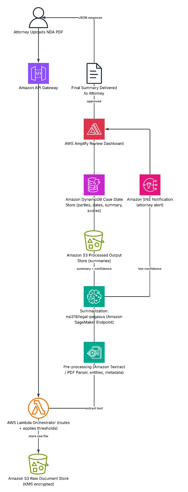
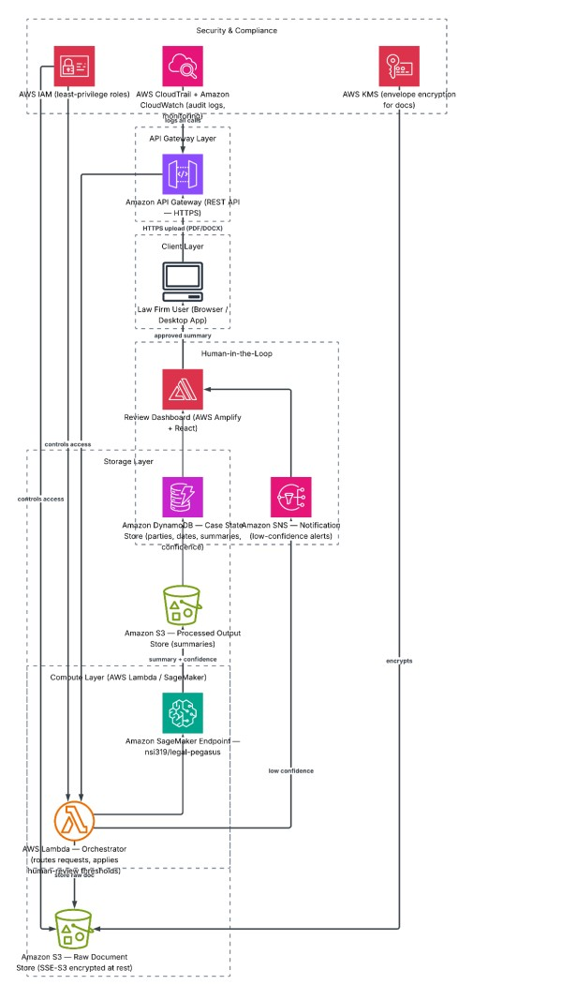

# LexiAI: Legal Document Summarization (Proof of Concept)

LexiAI is a proposed AI assistant for law firms: it summarizes NDAs clause by clause, flags risky clauses and explains legal wording in plain language, with an attorney approving every final summary.

Team project for MIS 425 (AI for Business Applications) at San Diego State University, Spring 2026, by team Law InnovAItions: Nikolai Kim, Michael Rodriguez, Julrenza Robert Flores, Long Nguyen and Jonah Mathewson.

**My part:** I wrote the report's agent design (PEAS), AI workflow and architecture sections, and contributed to the architecture design and the prototype notebook.

## Prototype results

The notebook compares a legal-domain summarizer, [nsi319/legal-pegasus](https://huggingface.co/nsi319/legal-pegasus), with a generic baseline, t5-base, on 10 NDAs: 2 public university templates and 8 synthetic agreements, each with a short reference summary.

| Metric | t5-base | legal-pegasus |
|---|---|---|
| ROUGE-1 | 0.266 | **0.350** |
| ROUGE-2 | 0.068 | **0.075** |
| ROUGE-L | 0.176 | **0.192** |
| Legal-term coverage | 16.0% | **33.4%** |
| Missed-keyword severity (lower is better) | 98 | **68** |

## What we learned

- **The legal model captures more legal substance.** It roughly doubles coverage of key legal terms (confidentiality, governing law, survival and so on) and misses fewer important keywords.
- **It also invents content.** In 3 of 10 summaries it opens with text that isn't in the NDA, such as "The U.S. Attorney's Office... announced today". legal-pegasus was fine-tuned on SEC litigation releases, which are press releases, so it sometimes falls back to that style. ROUGE doesn't catch this, which is why the design keeps an attorney in the loop.
- **The confidence comparison is unreliable.** legal-pegasus scores near zero most likely because of how the score is computed with beam search, not because the model is unsure. The notebook explains the issue and a fix.
- **The sample is small.** With 10 documents, these results are indicative only.

Notes marked **2026 review note** in the notebook were added when it was published; the code and saved outputs are unchanged from the course submission.

## Proposed AWS design (designed, not deployed)

An attorney uploads an NDA through API Gateway. Lambda stores it in encrypted S3, extracts the text with Textract and sends it to a SageMaker endpoint running legal-pegasus. Summaries and confidence scores go to S3 and DynamoDB. Low-confidence results trigger an SNS alert, and attorneys approve or reject every summary in an Amplify review dashboard. IAM, KMS, CloudTrail and CloudWatch handle access, encryption and auditing.

The agent is framed as a **model-based reflex agent** (PEAS): it keeps a case state across documents and escalates to an attorney when confidence falls below 0.70.

The team estimated about $25 a month in AWS costs for 100 documents (about $0.25 per document). These are projections from AWS pricing, not measured costs.

| AI workflow | System architecture |
|---|---|
|  |  |

## What I would do next

- Fix the confidence metric and re-run the comparison
- Test on more NDAs, with reference summaries checked by a lawyer
- Add a check that flags summary sentences not supported by the source, such as names or organizations that don't appear in the NDA
- Compare models trained on contracts rather than SEC releases

## Run it

```
pip install -r requirements.txt
jupyter notebook lexiai_prototype.ipynb
```

The notebook downloads both models from Hugging Face on the first run (a few GB). It runs on a CPU but is much faster on a GPU, for example in Google Colab.

**Tools:** Python, Hugging Face Transformers, PyTorch, rouge-score, pandas, matplotlib
